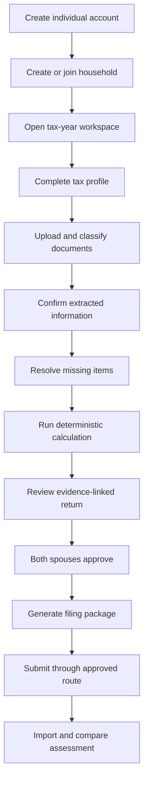
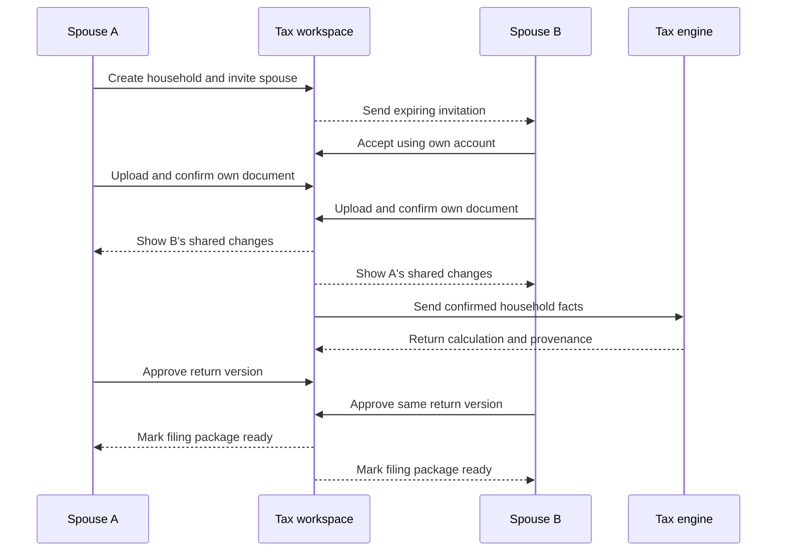
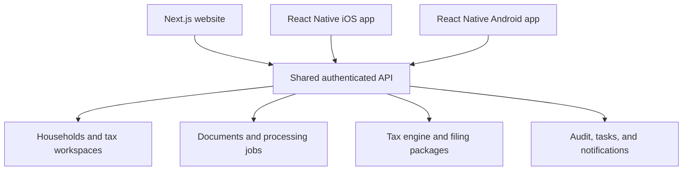
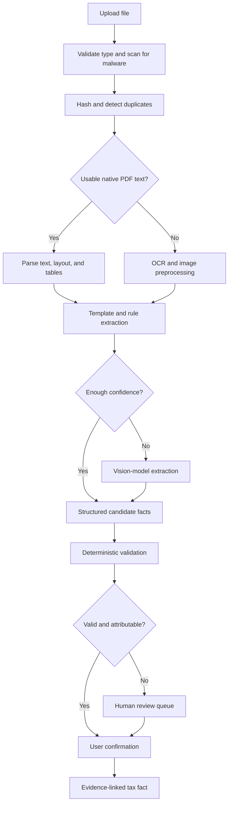
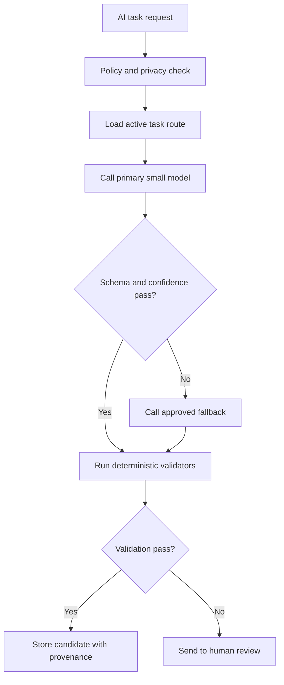
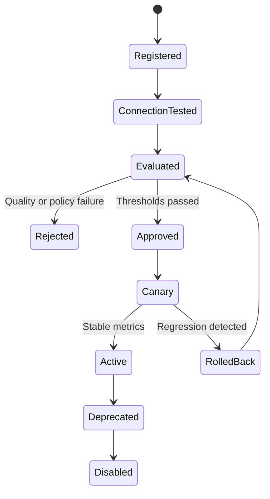
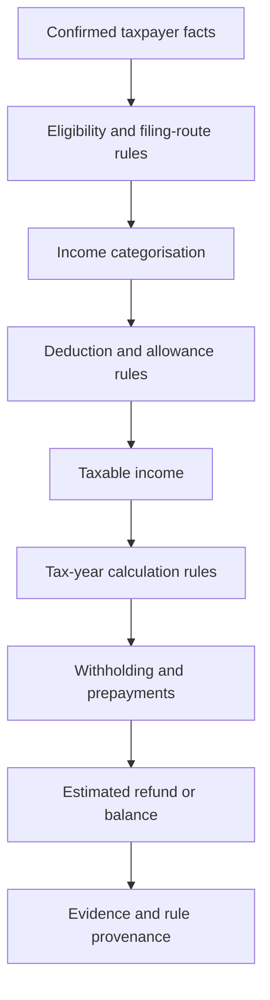
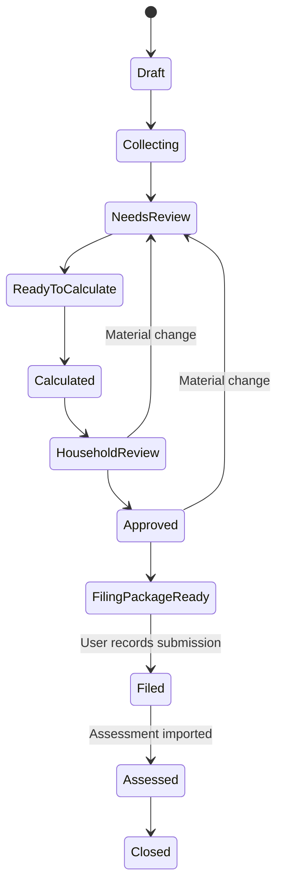
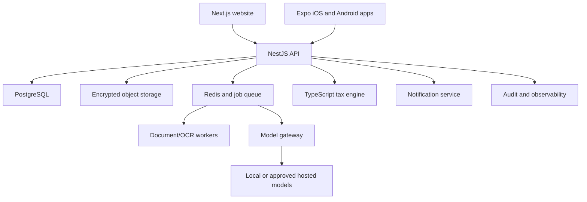
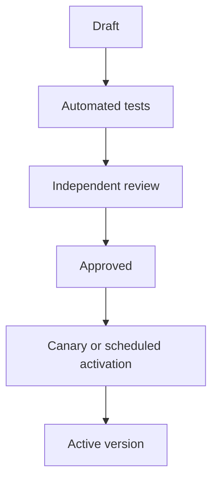

# Luxembourg Personal Tax Workspace

**Product and implementation plan**  
**Version:** 1.0  
**Planning date:** 22 September 2026  
**Primary stack:** Node.js / TypeScript  
**Initial market:** Luxembourg personal income tax  
**Product model:** Individual and joint-household tax preparation workspace

---

## 1. Executive summary

The product will be a secure Luxembourg personal-tax workspace available as a responsive website and native iOS and Android applications. An individual or married couple can collect documents throughout the year, extract information from receipts and PDFs, organise evidence, answer a guided questionnaire, calculate an explainable tax estimate, prepare official forms, review every value, and produce a filing-ready package.

The application should not begin as an autonomous tax-filing robot. The first reliable release should prepare and validate the return while the taxpayer remains responsible for reviewing, approving, signing, and submitting it. Direct MyGuichet submission can be added only after its technical, contractual, legal, mandate, and electronic-signature requirements have been confirmed.

The product will be built around five principles:

1. **Household-first:** spouses use separate accounts but can collaborate in one joint workspace.
2. **Evidence-linked:** every declared value links back to its source document, page, extraction, and edit history.
3. **Deterministic tax calculations:** AI extracts and explains information; tested TypeScript rules calculate taxes.
4. **Human-approved:** uncertain or legally significant information is confirmed before it affects a return.
5. **Model-independent:** administrators can change models, prompts, routes, and fallbacks without changing application code.

This document is a product and engineering plan, not legal or tax advice. Tax rules, forms, filing periods, licensing requirements, and MyGuichet capabilities must be revalidated for every tax year before release.

---

## 2. Product vision

### 2.1 Product promise

> Upload tax documents as they arrive. The workspace organises them, extracts the relevant facts, shows what is missing, calculates a traceable estimate, and prepares a Luxembourg return that every household member can confidently review.

### 2.2 Primary customer problem

Individuals and couples often collect documents in different places, do not know which information is relevant, struggle to map documents to tax-form fields, and cannot easily explain where a calculated amount came from. Existing filing workflows generally begin near the filing deadline; this product should work throughout the year.

### 2.3 Differentiation

The product should differentiate itself through:

- Year-round document collection;
- Joint-household collaboration;
- Precise attribution of income and expenses to each spouse;
- Full change history;
- Document-to-field traceability;
- Missing-document detection;
- Explainable tax estimates;
- Tax-year rollover;
- Assessment-versus-declaration comparison;
- Optional professional review;
- Replaceable local or hosted AI models.

### 2.4 Product boundaries

The initial application is for **personal income tax**, not corporate accounting, payroll, VAT accounting, or company annual accounts.

The first production scope should favour common, well-testable scenarios. Complex cases can be released later behind eligibility checks.

---

## 3. Scope and release boundaries

### 3.1 Initial supported scope

- Luxembourg personal tax workspace;
- One-person and two-person household workspaces;
- Separate user accounts for spouses;
- Tax-year-specific workspaces;
- Secure image and PDF uploads;
- Native PDF parsing and OCR;
- AI-assisted document classification and field extraction;
- Manual entry and correction;
- Source-linked values;
- Guided tax profile and questionnaire;
- Missing-information checklist;
- Deterministic tax estimation;
- Joint household review;
- Completed draft forms or guided field-transfer package;
- Supporting-document package;
- Final household approval;
- Audit history;
- Admin-controlled tax rules, models, prompts, and forms;
- English, French, and German interface foundations;
- Responsive desktop, tablet, and mobile experience;
- Native iOS and Android applications using the same accounts, households, API, and data as the website;
- Mobile camera capture, document picker, secure session storage, biometric re-entry, deep links, and push notifications;
- Resumable mobile upload queue for interrupted connections.

### 3.2 Later scope

- Non-resident and cross-border scenarios;
- Foreign income and remote-working-day tracking;
- Rental-property schedules;
- Self-employed income;
- Investment and capital-income workflows;
- Multiple properties and ownership shares;
- Tax-professional review portal;
- Subscription billing;
- Bank transaction import through an authorised provider;
- Email document ingestion;
- Platform-specific mobile enhancements such as share extensions and advanced document scanning;
- Luxembourgish and Portuguese interface expansion;
- Official electronic submission integration;
- Mandate management;
- Electronic-signature workflows.

### 3.3 Explicit non-goals for the first release

- Storing LuxTrust PINs, passwords, or signing secrets;
- Automating a taxpayer's browser session to imitate a MyGuichet submission;
- Letting an LLM calculate final tax amounts;
- Automatically accepting every extracted value;
- Providing unreviewed personalised legal advice;
- Supporting every rare Luxembourg tax case in the MVP;
- Training models on customer documents without explicit legal basis and consent;
- Allowing support staff unrestricted access to tax documents.

---

## 4. End-to-end product journey



### 4.1 User-visible stages

1. **Set up:** identity, tax year, residence, filing situation, household members.
2. **Collect:** upload documents manually or from approved future integrations.
3. **Organise:** extract, classify, attribute, and de-duplicate documents.
4. **Complete:** answer targeted questions and resolve missing evidence.
5. **Calculate:** run the versioned tax engine and display an estimate.
6. **Review:** inspect values, sources, warnings, and household changes.
7. **Approve:** collect separate approval from each required taxpayer.
8. **Prepare/file:** generate forms, annexes, evidence, and transfer guidance.
9. **Reconcile:** compare the official assessment with the filed return.
10. **Roll forward:** copy reusable profile information into the next tax year.

---

## 5. Users, roles, and permissions

### 5.1 Product roles

| Role | Purpose | Default document access |
|---|---|---|
| Individual taxpayer | Manages a personal return | Own workspace only |
| Household member A | Joint taxpayer with separate login | Shared return plus own private drafts |
| Household member B | Joint taxpayer with separate login | Shared return plus own private drafts |
| Professional reviewer | Reviews assigned cases with permission | Explicitly assigned scopes only |
| Technical support agent | Resolves technical issues | Metadata only by default |
| Tax-content administrator | Manages forms, guidance, and rules | No customer documents by default |
| Model administrator | Manages AI providers and routes | Evaluation data only by default |
| Security/compliance auditor | Reviews audit and control evidence | Read-only, purpose-limited access |
| Platform administrator | Operates the service | No automatic plaintext document access |

### 5.2 Permission principles

- Every human uses an individual account; shared credentials are forbidden.
- Household co-filers have equal approval rights over a joint return.
- Administrative role does not imply access to taxpayer documents.
- Elevated access is time-bound, reason-coded, logged, and reviewable.
- Documents begin as private drafts or household-shared items.
- Information included in the joint return becomes visible to both filers.
- Filed historical returns are immutable snapshots.
- Removal from a household affects future access but must not corrupt filed records.

---

## 6. Joint-household workspace

The household workspace is a core domain concept, not a later sharing feature.

### 6.1 Membership model

- A user creates a household for a selected tax year.
- The user invites a spouse through a single-use, expiring invitation.
- The invited spouse signs in or creates a separate account.
- The spouse sees the household name, tax year, inviter, and requested access before accepting.
- Both accounts become co-filers once the invitation is accepted.
- Membership changes create immutable audit events.
- A household may have linked children and dependants without giving them user accounts.

### 6.2 Information ownership

Each item must identify one of the following owners:

- Household member A;
- Household member B;
- Both members jointly;
- A child or dependant;
- The household generally;
- An externally owned asset with a declared ownership share.

### 6.3 Document visibility states

| State | Visible to uploader | Visible to spouse | Used in calculation |
|---|---:|---:|---:|
| Private draft | Yes | No | No |
| Shared for discussion | Yes | Yes | No |
| Proposed for return | Yes | Yes | Only after validation policy passes |
| Included in return | Yes | Yes | Yes |
| Archived/rejected | Yes | According to prior sharing | No |

Before a private document is used in a joint calculation, the application must explain that its relevant information and evidence will become visible to the co-filer.

### 6.4 Household collaboration workflow



### 6.5 Change history

Every material event records:

- Actor type and actor ID;
- Household and tax-year workspace;
- Action type;
- Entity and field affected;
- Previous and new values, with sensitive-data handling;
- Timestamp in UTC;
- Request/correlation ID;
- Source interface or agent;
- Model, prompt, and schema version when AI was involved;
- Reason or comment when required;
- Approval version invalidated by the change, if applicable.

The activity feed should render understandable statements such as:

> 21 September 2026, 18:42 — Household member B changed mortgage interest from €3,250.00 to €3,520.00 using the bank certificate on page 2.

### 6.6 Approval invalidation

Any material change after a spouse approves the return must:

1. Create a new return version;
2. Mark previous approvals as superseded;
3. Explain what changed;
4. Require the applicable spouses to approve again.

Comments, read-status changes, and harmless display preferences should not invalidate approvals.

---

## 7. Functional product modules

### 7.1 Identity and authentication

- Email verification;
- Passkeys and/or strong password authentication;
- Multi-factor authentication;
- Secure recovery process;
- Session and device management;
- Suspicious-login alerts;
- Configurable session expiry;
- Household invitations;
- Consent capture;
- Account export and deletion requests;
- Future identity-provider abstraction.

### 7.2 Tax-year workspace

- One workspace per household and tax year;
- Filing route and eligibility status;
- Tax profile snapshot;
- Return version;
- Completion score;
- Missing-item count;
- Calculation status;
- Approval status for each filer;
- Filing-package version;
- Submission state;
- Assessment state;
- Historical read-only snapshot after filing.

### 7.3 Document vault

- Drag-and-drop upload;
- Mobile camera upload;
- PDF, JPEG, PNG, and approved image types;
- File-type verification independent of extension;
- File-size and page-count limits;
- Malware scanning;
- Encrypted object storage;
- Thumbnail and preview generation;
- Multi-page document grouping and splitting;
- Duplicate and near-duplicate detection;
- Private/shared/included visibility;
- Tags, document date, tax year, and owner;
- Version replacement without deleting history;
- Download and deletion controls;
- Retention policy enforcement.

### 7.4 Tax profile and guided interview

The questionnaire adapts to the household rather than displaying the complete tax form.

Topics include:

- Residence and tax residence;
- Marital and household status;
- Filing preference and eligibility;
- Employment and pension income;
- Self-employment where supported;
- Luxembourg and foreign income;
- Children and dependants;
- Childcare and household expenses;
- Properties, loans, and rental income;
- Insurance and pension contributions;
- Donations;
- Investments and capital income;
- Exceptional expenses;
- Prior-year carry-forward information;
- Cross-border and remote-working facts where supported.

The application must distinguish:

- Required question;
- Optional question;
- Question not applicable;
- Answered by user;
- Suggested from a document;
- Pre-filled from prior year;
- Confirmed for the current year.

### 7.5 Missing-information engine

The rules engine should generate tasks such as:

- Missing salary certificate for a declared employer;
- Mortgage interest declared without supporting certificate;
- Foreign income indicated without country or amount;
- Document belongs to another tax year;
- Both spouses supplied conflicting household information;
- An extracted value has not been confirmed;
- A required annex has not been completed;
- Ownership percentages do not total the expected amount;
- A material value changed after approval.

### 7.6 Tax estimate and scenario comparison

- Estimated taxable income;
- Estimated tax liability;
- Withholding and prepayments;
- Estimated refund or balance payable;
- Calculation timestamp and tax-rule version;
- Breakdown by income and deduction category;
- Comparison with previous calculation version;
- Joint/individual scenario comparison only where legally supported;
- Clear assumptions and unresolved warnings;
- No guarantee language;
- Source and rule traceability for every material amount.

### 7.7 Form and filing-package generator

- Map confirmed facts to official form fields;
- Generate a review copy;
- Generate annexes applicable to the case;
- Assemble supporting documents in a controlled order;
- Produce an evidence index;
- Produce a field-transfer guide for MyGuichet;
- Show fields the application could not complete;
- Record form template and mapping versions;
- Hash generated outputs;
- Require final review before download;
- Never silently submit.

### 7.8 Post-filing assessment module

- Record filing date and route;
- Store submission confirmation;
- Upload official assessment;
- Extract assessed amounts;
- Compare declared and assessed values;
- Explain detected differences without claiming legal certainty;
- Track follow-up and objection dates;
- Allow professional review;
- Freeze the filed return and assessment pair;
- Carry reusable profile information into the next tax year.

### 7.9 Notifications and tasks

- Household invitation;
- Document needs confirmation;
- Spouse changed a material field;
- Missing-document reminder;
- Deadline reminder;
- Return ready for review;
- Approval requested;
- Approval invalidated after a material change;
- Filing package generated;
- Assessment follow-up due;
- Security and new-device alerts.

Users must control ordinary email and push notifications. Security notices and legally necessary service notices are handled separately.

---

## 8. User experience and navigation

### 8.1 User menu

| Menu item | Main purpose |
|---|---|
| Dashboard | Progress, estimate, deadlines, warnings, and recent household changes |
| Household | Members, dependants, ownership, invitations, and permissions |
| Tax profile | Guided personal and household questionnaire |
| Documents | Upload, review, classify, share, and search evidence |
| Income | Income sources and supporting documents by person |
| Deductions | Confirmed and potential deductible items |
| Properties | Ownership, mortgages, interest, and rental data |
| Investments | Supported investment and capital-income information |
| Missing information | Prioritised tasks and unresolved questions |
| Tax estimate | Calculation breakdown, assumptions, and scenarios |
| Forms and filing | Form preview, evidence package, approvals, and submission guidance |
| Assessment | Official assessment import and comparison |
| Activity | Searchable household audit history |
| Settings and privacy | Security, sessions, consent, export, deletion, and notifications |

### 8.2 Dashboard information architecture

The primary dashboard should show:

- Overall readiness percentage;
- Readiness per household member;
- Current estimated refund or balance;
- Estimate confidence/readiness state;
- Critical warnings;
- Missing documents;
- Items awaiting each spouse;
- Filing deadline;
- Latest shared changes;
- Approval states;
- One clear recommended next action.

### 8.3 UX rules

- Show plain-language questions before tax-form terminology.
- Allow users to inspect the official form mapping when they want detail.
- Never hide warnings solely to improve the completion score.
- Clearly distinguish AI suggestions from confirmed facts.
- Display currency with locale-aware formatting while storing decimal values precisely.
- Make tax year visible on every major workspace screen.
- Make the active household visible to prevent cross-household mistakes.
- Prevent accidental destructive actions with confirmation and recovery windows.
- Maintain feature parity across desktop, tablet, and mobile for core tasks.

### 8.4 Native iOS and Android applications

The iOS and Android apps are first-class clients of the same platform. They must not maintain a separate tax database or separate business rules. Website, iOS, and Android use the same authenticated API, household permission model, tax engine, model-processing jobs, audit history, and filing-package records.

The recommended implementation is **React Native with Expo and TypeScript**, using Expo Router for mobile navigation. This provides genuine native camera, secure storage, biometrics, document picker, notifications, and app-store distribution while preserving a shared TypeScript ecosystem with the web and API projects.

A WebView or basic Capacitor wrapper is not recommended as the primary mobile product because secure receipt capture, background/resumable uploads, biometrics, native navigation, push notifications, and polished app-store behaviour are central to this application.

### 8.5 Shared-client architecture



Code shared across clients should include:

- API contracts and generated client types;
- Runtime validation schemas;
- Authentication/session protocol;
- Tax-domain enums and status labels;
- Currency and date formatting rules;
- Error codes and user-safe error mapping;
- Feature-flag client;
- Design tokens;
- Analytics and consent contracts;
- Selected non-visual state and domain helpers.

Web DOM components and React Native components should not be forced into one universal UI layer when that damages accessibility or native behaviour. Share tokens, contracts, validation, and domain logic first; share visual components only where they work well on every platform.

### 8.6 Mobile navigation

Recommended bottom navigation:

- Home;
- Documents;
- Tasks;
- Estimate;
- Account.

Household switching, tax-year switching, activity, and forms remain available through contextual menus. Complex form review can use responsive native screens rather than embedding the website.

### 8.7 Mobile document capture

The mobile apps should provide:

- Camera capture with edge guidance;
- Automatic rotation and perspective correction where supported;
- Multi-page document scanning;
- Import from Files, iCloud Drive, device storage, and supported Android providers;
- Import from the photo library with explicit permission;
- Page preview, reorder, rotate, crop, retake, and delete;
- Document-owner selection before upload;
- Private/shared visibility selection;
- Tax-year selection with sensible default;
- Image-quality checks for blur, glare, cropping, and unreadable text;
- Compression that preserves OCR readability;
- Resumable upload with checksum verification;
- Clear local-copy deletion after successful upload according to policy.

### 8.8 Offline and unreliable-network behaviour

The application is online-first because authoritative household state, permissions, and calculations live on the server. Limited offline capability should include:

- Capture documents while offline;
- Encrypted local pending-upload queue;
- Retry when connectivity returns;
- Draft document metadata;
- Previously downloaded non-sensitive shell/navigation data where appropriate;
- Visible offline and synchronisation status;
- Conflict-safe reconciliation when server state changed.

Do not cache full tax returns, source PDFs, or extracted financial data indefinitely on the device. Any temporary file must have an explicit lifecycle and secure deletion policy.

### 8.9 Mobile authentication and device security

- Store refresh/session secrets only in iOS Keychain or Android Keystore-backed secure storage;
- Never store tokens in unencrypted AsyncStorage;
- Use short-lived access tokens and server-side revocation;
- Offer Face ID, Touch ID, or Android biometrics for local re-entry;
- Treat biometrics as local protection, not a replacement for server authentication;
- Reauthenticate for high-risk actions such as household removal, data export, and final approval;
- Support device/session listing and remote logout;
- Clear sensitive memory and temporary files after use where practical;
- Hide sensitive screen content in the app switcher;
- Consider screenshot blocking only for highly sensitive screens, with accessibility and user-experience review;
- Detect rooted/jailbroken-device signals only as risk indicators, not infallible proof.

### 8.10 Deep links and invitations

Use verified iOS Universal Links and Android App Links for:

- Household invitations;
- Passwordless or account-verification handoff;
- Notification routing;
- Opening a specific document-review task;
- Opening an approval request.

Deep links must never contain income amounts, tax identifiers, document text, authentication tokens intended for reuse, or other sensitive information. Invitation tokens are single-use, short-lived, server-validated, and safe to reject after household state changes.

### 8.11 Push notifications

Push notifications may say:

- “A household document needs your review.”
- “Your joint return is ready for approval.”
- “A filing deadline is approaching.”

They should not display salary, refund amount, tax balance, document title containing sensitive information, or other financial details on a locked screen. Notification taps open the appropriate authenticated screen after access is revalidated.

### 8.12 Mobile release and update strategy

- Separate development, preview/internal, and production app configurations;
- Distinct iOS bundle identifiers and Android application IDs per environment where appropriate;
- Signed builds through controlled CI/CD;
- TestFlight for iOS beta testing;
- Google Play internal and closed testing tracks;
- Staged production rollout;
- Crash and performance monitoring configured to exclude sensitive content;
- Backward-compatible APIs because users do not update store apps immediately;
- Minimum-supported-version policy with a graceful upgrade screen;
- Emergency server-side feature flags;
- Over-the-air JavaScript updates only within platform rules, signed release policy, and compatibility limits;
- Store metadata, privacy labels/data-safety declarations, screenshots, review notes, and account-deletion instructions maintained as versioned release artefacts.

### 8.13 Mobile performance requirements

- Measure cold-start time rather than guessing;
- Profile receipt lists and activity feeds before applying memoisation;
- Use virtualised lists for large document/activity collections;
- Keep OCR and tax calculations off the JavaScript/UI thread;
- Upload in background-capable, bounded chunks where platform rules allow;
- Generate small thumbnails rather than rendering full-resolution documents in lists;
- Monitor memory during multi-page scanning and PDF preview;
- Analyse JavaScript and native app size before every major release;
- Enable Android code shrinking for production after validation;
- Test camera, biometrics, secure storage, permissions, and notifications on real devices.

---

## 9. Document intelligence pipeline

### 9.1 Processing workflow



### 9.2 Extraction hierarchy

Use the lowest-risk method that can reliably complete the task:

1. Native PDF text and metadata;
2. Known document template parser;
3. Regex and deterministic field rules;
4. OCR and layout analysis;
5. Small language model over extracted text;
6. Small vision-language model over relevant pages;
7. Larger configured fallback model;
8. User or professional review.

### 9.3 Supported document record

Every document record should contain:

- Original immutable object;
- Display filename and original filename;
- MIME type verified from content;
- Cryptographic hash;
- Perceptual hash where applicable;
- Page count;
- Uploader;
- Household and tax year;
- Declared owner;
- Visibility state;
- Document classification and confidence;
- Extracted facts and bounding/source locations;
- Processing attempts;
- Models and versions used;
- User confirmations and corrections;
- Retention and deletion state.

### 9.4 Field extraction contract

AI extraction must return a strict schema. A conceptual example:

```json
{
  "documentType": "salary_certificate",
  "taxYear": 2026,
  "candidateOwnerId": "member_uuid",
  "ownerConfidence": 0.93,
  "fields": {
    "grossSalary": {
      "value": "52340.18",
      "currency": "EUR",
      "page": 1,
      "sourceText": "Rémunération brute ...",
      "confidence": 0.98
    }
  },
  "warnings": [],
  "requiresHumanReview": false
}
```

Money values are represented as decimal strings in transport contracts and fixed-precision decimals in the database, never binary floating-point values.

### 9.5 Validation examples

- Date parses and belongs to a plausible tax period;
- Currency is supported and explicit;
- Totals reconcile where the document exposes components;
- Negative amounts are permitted only for appropriate fields;
- Owner matches available household identity information;
- Matricule-like identifiers are never written to logs;
- Same certificate has not already been included;
- Page reference and source text exist;
- Field is permitted for the classified document type;
- Required extraction schema is satisfied.

---

## 10. AI and model architecture

### 10.1 Core rule

AI may propose, classify, extract, summarise, explain, and identify anomalies. AI must not be the authoritative source for tax formulas, submission decisions, consent, signatures, or household approvals.

### 10.2 Initial model candidates

These are replaceable starting candidates, not permanent dependencies.

| Capability | Initial candidate | Use |
|---|---|---|
| PDF/layout parsing | Docling | Native PDF text, structure, tables, reading order |
| OCR/layout | PaddleOCR / PP-StructureV3 | Scans, photos, document structure |
| Vision document understanding | Qwen3-VL-4B-Instruct | Difficult receipts and form pages |
| Text classification/extraction | Qwen3.5-4B | Narrow JSON extraction and classification |
| User explanations | Qwen3.5-4B with configurable stronger fallback | Plain-language explanations and guided questions |
| Embeddings | BGE-M3 or multilingual-e5-small | Retrieval across multilingual official guidance |
| Reranking | Optional multilingual reranker | Improve retrieved tax-source relevance |
| PII patterns | Deterministic recognisers | Redaction, masking, and logging protection |

All candidates must pass a Luxembourg-specific benchmark before production activation.

### 10.3 Task-based model routing



### 10.4 Model registry

The admin-controlled model registry stores:

- Display name;
- Provider type;
- Provider-specific model identifier;
- Base URL;
- Capability flags: text, vision, embedding, reranking;
- Supported languages;
- Context and output limits;
- Quantisation and deployment format;
- Local, private-cloud, or external-hosted classification;
- Permitted data classes;
- Processing region and data-residency metadata;
- Timeout and concurrency limits;
- Rate and cost metadata;
- Health-check configuration;
- Model artefact/version hash where available;
- Licence metadata;
- Lifecycle status;
- Encrypted secret reference, never the plaintext secret.

### 10.5 Provider adapters

The application should expose one internal inference contract with adapters for:

- Ollama;
- vLLM;
- llama.cpp server;
- OpenAI-compatible APIs;
- Custom internal HTTP inference services;
- Approved external providers.

Provider credentials remain server-side. Custom endpoints require allowlisting and protection against server-side request forgery.

### 10.6 Task routes

Each AI task has an independently deployable route containing:

- Task name;
- Primary model;
- Ordered fallback models;
- Prompt-template version;
- Output-schema version;
- Temperature and generation limits;
- Timeout and retry policy;
- Confidence policy;
- Permitted data classification;
- External-processing permission;
- Human-review policy;
- Active rollout percentage;
- Evaluation result and approver.

Example tasks:

- `document.classify`;
- `document.extract.salary_certificate`;
- `document.extract.receipt`;
- `document.owner_suggestion`;
- `return.missing_information`;
- `return.anomaly_review`;
- `assistant.explain_calculation`;
- `assistant.guided_question`;
- `assessment.compare`;
- `content.translate_draft`.

### 10.7 Model activation workflow



### 10.8 Model administration requirements

- Register, edit, disable, and test models;
- Compare candidate and active models on the same evaluation set;
- View accuracy, hallucination, latency, failure, and cost metrics;
- Activate by task, not globally;
- Canary by percentage or internal test tenants;
- Immediate rollback;
- Prevent unapproved external models from receiving sensitive documents;
- Prevent configuration changes from altering historical results;
- Explicitly reprocess selected documents into a new result version;
- Preserve original extraction and all subsequent versions;
- Require two-person approval for production model routes if operating commercially.

### 10.9 Prompt and schema management

- Prompts are versioned records, not strings hidden in source files;
- Production prompts are immutable after publication;
- Prompt changes pass the same evaluation workflow as model changes;
- JSON schema validation occurs before results enter the domain layer;
- Retrieved tax content includes source identifier, tax year, and effective date;
- User-provided document text is separated from system instructions;
- Model output is treated as untrusted input;
- Prompt-injection text inside uploaded documents cannot call tools or alter policies.

### 10.10 Fine-tuning strategy

Do not fine-tune in the MVP. Begin with narrow prompts, tax dictionaries, schemas, retrieval, validators, and user corrections.

Fine-tuning or LoRA adapters may be introduced later only when:

- A lawful and documented training-data basis exists;
- Training examples are consented and appropriately anonymised;
- A representative evaluation set exists outside the training set;
- The adapter is versioned as a new model artefact;
- Regression, privacy, and memorisation tests pass;
- Rollback is available.

---

## 11. Luxembourg-specific model evaluation

### 11.1 Golden dataset

Create a versioned, anonymised evaluation set containing representative examples of:

- Salary certificates;
- Pension certificates;
- Insurance and pension-contribution certificates;
- Bank-interest and mortgage certificates;
- Donation certificates;
- Childcare invoices;
- Rental-property statements;
- Ordinary receipts;
- Foreign-income certificates;
- Official forms and annexes;
- Digital PDFs, scans, mobile photographs, skew, blur, and low contrast;
- French, German, English, and mixed-language documents;
- Similar-looking documents from different tax years;
- Duplicate and partially duplicated files.

### 11.2 Metrics

- Document-type classification precision, recall, and F1;
- Exact match for amounts, dates, tax years, and identifiers;
- Owner-attribution accuracy;
- Page/source-location accuracy;
- Hallucinated-field rate;
- Schema-valid response rate;
- Validator failure rate;
- Human-review rate;
- Latency by page and document;
- Peak RAM/VRAM;
- Cost per document for hosted routes;
- Performance by language and scan quality.

### 11.3 Release rule

No model is approved solely from generic public benchmarks. It must outperform or safely complement the existing production route on the application's own anonymised test cases.

Fields with significant tax effect require user confirmation even when the extraction score is high. Confidence thresholds may prioritise review but do not replace taxpayer approval.

---

## 12. Deterministic tax engine

### 12.1 Responsibilities

The tax engine receives confirmed facts and produces:

- Eligibility and filing-path indicators;
- Categorised income;
- Applicable deductions and limits;
- Taxable-income calculation;
- Tax calculation according to the activated tax-year rules;
- Withholding and payment offsets;
- Estimated refund or balance;
- Scenario comparisons where supported;
- Warnings and assumptions;
- Complete calculation provenance.

### 12.2 Tax-year rule packages

Each tax year is an immutable package containing:

- Rule identifiers;
- Formula implementations;
- Thresholds, caps, allowances, and rates;
- Effective dates;
- Eligibility conditions;
- Filing-form versions;
- Field mappings;
- Official source links and retrieval dates;
- Examples and unit tests;
- Reviewer and approval information;
- Package version and checksum.

Corrections create a new package version. Existing filed returns retain the exact rule package used at filing time.

### 12.3 Calculation workflow



### 12.4 Calculation provenance

Every output line should answer:

- What value was used?
- Which household member or shared item owns it?
- Which source document or manual answer supplied it?
- Which tax rule transformed it?
- Which limit or threshold was applied?
- Which tax-year rule package was active?
- What changed since the previous calculation?

### 12.5 Calculation safety

- Use fixed-precision decimal arithmetic;
- Store original and normalised currencies separately;
- Version exchange-rate sources where relevant;
- Make rounding rules explicit and testable;
- Refuse unsupported scenarios instead of guessing;
- Separate tax estimate from official assessment;
- Never copy an LLM-generated number directly into the authoritative calculation state;
- Require deterministic validation of all model-extracted numeric values.

---

## 13. Return lifecycle and filing strategy

### 13.1 Return state machine



### 13.2 Filing levels

#### Level 1 — Preparation and export

- Produce form drafts;
- Produce evidence index and attachment package;
- Produce calculation report;
- Require final household approval;
- User files through the official channel.

#### Level 2 — Guided MyGuichet transfer

- Show destination sections and fields;
- Present confirmed values alongside evidence;
- Provide a completion checklist;
- User authenticates and signs directly on the official platform.

#### Level 3 — Approved submission integration

Implement only after confirming:

- A supported technical interface;
- Authentication and electronic-signature requirements;
- Joint-signature handling;
- Mandate requirements;
- Permitted service-provider role;
- Audit and retention obligations;
- Liability and customer-support procedures.

#### Level 4 — Professional filing service

- Taxpayer grants an appropriate mandate;
- Authorised professional reviews the return;
- Professional locks the reviewed version;
- Required taxpayers approve/sign;
- Submission confirmation is returned to the workspace.

### 13.3 Submission prohibitions

- Never store a LuxTrust PIN;
- Never forge or replay a signature;
- Never report a return as filed without official confirmation or explicit user record;
- Never allow a spouse to approve as the other spouse;
- Never use fragile browser automation as the legal submission mechanism;
- Never let a model decide that unresolved warnings are safe to ignore.

---

## 14. Technical architecture

### 14.1 Recommended foundation

- **Web application:** Next.js and TypeScript;
- **Native applications:** React Native with Expo, Expo Router, and TypeScript;
- **API:** NestJS with Fastify;
- **Database:** PostgreSQL;
- **ORM/migrations:** Prisma or an equivalently controlled TypeScript data layer;
- **Object storage:** EU-hosted S3-compatible encrypted storage;
- **Queue:** Redis and BullMQ;
- **Tax engine:** Independent versioned TypeScript package;
- **Document workers:** Python service for Docling/PaddleOCR where appropriate;
- **Model gateway:** Internal service exposing a provider-neutral contract;
- **Search:** PostgreSQL full-text initially; dedicated search only when justified;
- **Observability:** OpenTelemetry-compatible traces, metrics, and structured logs;
- **Deployment:** Containerised services with separate worker scaling.

The main product remains Node.js. A small isolated Python worker is appropriate for mature document-AI libraries and avoids rebuilding them poorly in JavaScript.

### 14.2 System architecture



### 14.3 Modular monolith first

Begin with a modular monolith for the API and separate only the heavy asynchronous workers. Suggested domain modules:

- Identity;
- Households;
- Tax years;
- Tax profiles;
- Documents;
- Extracted facts;
- Rules and calculations;
- Forms;
- Filing packages;
- Approvals;
- Assessments;
- Tasks and notifications;
- Professional review;
- Admin and configuration;
- Model registry and routing;
- Audit and compliance.

Avoid premature microservices. Domain boundaries and asynchronous events should make later separation possible.

### 14.4 Suggested repository layout

```text
apps/
  web/
  mobile/
  api/
  document-worker/
  model-gateway/
packages/
  tax-engine/
  tax-rules/
  form-mappings/
  contracts/
  validation/
  ui/
  mobile-ui/
  api-client/
  design-tokens/
  config/
infra/
  containers/
  migrations/
  observability/
docs/
  architecture/
  product/
  security/
  tax-sources/
  decisions/
tests/
  fixtures/
  tax-golden/
  model-evaluations/
```

### 14.5 High-level API areas

```text
/auth
/users
/households
/households/:id/members
/tax-years
/workspaces
/documents
/documents/:id/extractions
/facts
/questionnaires
/tasks
/calculations
/returns
/approvals
/filing-packages
/assessments
/activity
/admin/tax-rules
/admin/forms
/admin/models
/admin/model-routes
/admin/evaluations
/admin/audit
```

APIs require object-level authorisation checks. Knowing a UUID must never be sufficient to access an object.

---

## 15. Core data model

### 15.1 Principal entities

| Entity | Purpose |
|---|---|
| User | Authentication identity and preferences |
| PersonProfile | Taxpayer facts separated from login identity |
| Household | Collaboration and tax-unit container |
| HouseholdMembership | Membership, role, status, and consent |
| Dependant | Child or dependant linked to a household |
| TaxYearWorkspace | Household work for a specific tax year |
| TaxProfileSnapshot | Versioned questionnaire answers |
| Document | Original file metadata and access state |
| DocumentVersion | Replacement and transformation history |
| ProcessingRun | OCR/model execution with provenance |
| ExtractedFact | Candidate field tied to document evidence |
| ConfirmedFact | User-approved input to tax calculations |
| TaxRulePackage | Immutable rules for a tax year |
| Calculation | Versioned calculation output |
| ReturnVersion | Frozen collection of facts and mappings |
| Approval | A person's approval of one exact return version |
| FilingPackage | Generated form and evidence artefacts |
| SubmissionRecord | Filing route, date, and confirmation |
| Assessment | Official assessment and extracted values |
| Task | Missing item, review, or household action |
| Comment | Discussion on a document, fact, or task |
| AuditEvent | Immutable material activity record |
| ModelDefinition | Registered model and deployment metadata |
| ModelRoute | Active model/prompt/schema for a task |
| EvaluationRun | Model-quality and regression result |

### 15.2 Relationship rules

- A user can belong to more than one household across time, but access is tax-year and membership-state aware.
- A tax-year workspace belongs to exactly one household.
- A document belongs to one workspace and has an uploader and declared owner.
- Confirmed facts are versioned and may cite one or more evidence locations.
- A calculation points to exact fact, rule-package, and exchange-rate versions.
- An approval points to exactly one return version.
- A material edit produces a new return version before new approvals.
- A filed return is never overwritten; amendments are separate versions.

---

## 16. Admin console

### 16.1 Admin navigation

| Section | Capabilities |
|---|---|
| Overview | Service health, queues, review backlog, safe aggregate metrics |
| Users | Account state, security actions, consent and support metadata |
| Households | Membership troubleshooting without unrestricted document viewing |
| Tax years | Open, close, and configure supported years |
| Tax rules | Draft, test, approve, publish, and deprecate rule packages |
| Forms | Upload and map official form versions and annexes |
| Document types | Schemas, fields, examples, and validation policies |
| Review queue | Low-confidence or failed processing cases with controlled access |
| Models | Provider-neutral model registry and health status |
| Model routes | Primary/fallback selection per AI task |
| Prompts and schemas | Versioned templates and structured-output contracts |
| Evaluations | Golden datasets, runs, comparisons, and approval decisions |
| Content | Help text, official references, translations, and effective dates |
| Notifications | Templates, schedules, and delivery status |
| Professionals | Reviewer eligibility, assignment, and access scopes |
| Security | Sessions, incidents, access events, and key status |
| Audit | Searchable immutable administrative audit trail |
| Privacy | Export, deletion, retention, and data-subject requests |
| Feature flags | Controlled rollout by environment and cohort |

### 16.2 Publishing workflows

Tax rules, form mappings, prompts, document schemas, and model routes use:



Production versions are immutable. Corrections create new versions and preserve the historical version used by existing calculations and returns.

---

## 17. Security, privacy, and compliance

### 17.1 Security baseline

- EU-based infrastructure where feasible and contractually verified;
- TLS for all communications;
- Encryption at rest for databases, objects, and backups;
- Additional application-level encryption for selected high-risk fields;
- Managed key rotation;
- MFA/passkey support;
- Least-privilege role and object-level access;
- Tenant/household isolation tests;
- Short-lived signed document URLs;
- Malware and archive-bomb protection;
- Content-type and image-decoder hardening;
- Secrets manager rather than environment files committed to source;
- Dependency and container scanning;
- Rate limiting and abuse controls;
- Encrypted, tested backups;
- Point-in-time database recovery;
- Incident-response and breach-notification procedures;
- Regular penetration tests before commercial launch.
- Mobile secrets stored through Keychain/Keystore-backed secure storage;
- No server secrets embedded in web or mobile bundles;
- Verified Universal Links and Android App Links;
- Sensitive data excluded from mobile crash reports, screenshots, and notification payloads;
- Mobile temporary-document cleanup and encrypted pending-upload policy.

### 17.2 Privacy by design

- Collect only information required for supported workflows;
- State the purpose for each sensitive data category;
- Separate service operation from optional model improvement;
- Do not train on taxpayer documents by default;
- Document every external processor and subprocessor;
- Apply configurable retention by data category;
- Support access, correction, export, objection, and deletion workflows;
- Preserve legally required records without retaining unnecessary originals;
- Complete a data-protection impact assessment before broad public use;
- Keep customer content out of ordinary application logs and analytics.

### 17.3 AI privacy policy

Each model route must declare the maximum data classification it can receive:

- Public tax guidance;
- Synthetic evaluation data;
- Redacted customer text;
- Identifiable customer text;
- Document images;
- Special-category or otherwise high-risk content.

An external provider cannot receive a higher data class than its approved contract, region, retention, and training settings allow.

### 17.4 Logging policy

Logs may include:

- Opaque IDs;
- Operation names;
- Durations;
- Status codes;
- Model and route versions;
- Validation outcomes;
- Safe error codes.

Logs must not include:

- Full document text;
- Matricule or tax identifiers;
- Bank-account numbers;
- Full names combined with income amounts;
- Authentication secrets;
- Generated filing forms;
- Raw model prompts containing customer documents.

### 17.5 Household security edge cases

- Reauthenticate before adding or removing a spouse;
- Notify both parties about membership changes;
- Require explicit sharing before private drafts join a return;
- Preserve the audit record of historical shared actions;
- Prevent one spouse from impersonating the other;
- Provide a controlled separation workflow;
- Restrict document exports to authorised members;
- Lock filed snapshots from deletion through ordinary UI actions;
- Provide emergency access revocation without destroying evidence.

### 17.6 Legal and operational gates

Before offering public paid service, obtain professional review of:

- Whether the chosen service description requires a Luxembourg business permit;
- Whether particular tax-advice or representation features require qualified professionals;
- Mandate and electronic-signature requirements;
- Consumer terms, disclaimers, and liability allocation;
- Professional indemnity insurance needs;
- Data-controller/processor roles;
- Retention periods;
- Cross-border processing;
- Subscription cancellation and consumer rights;
- Accessibility and language obligations.

---

## 18. Multilingual content and accessibility

### 18.1 Language strategy

Initial interface architecture should support:

- English;
- French;
- German;
- Luxembourgish as a planned language;
- Portuguese as a planned language.

Official tax terminology should use curated translations. AI-generated translations may be drafts but cannot silently overwrite approved legal or tax content.

Every content entry should have:

- Stable content key;
- Language;
- Tax year where applicable;
- Effective date;
- Source;
- Reviewer;
- Approval state;
- Version.

### 18.2 Accessibility

- Target WCAG 2.2 AA;
- Full keyboard support;
- Visible focus states;
- Semantic headings and form labels;
- Screen-reader announcements for upload and processing state;
- Text alternatives for status icons;
- Colour-independent warnings;
- Sufficient contrast;
- Error summaries linked to fields;
- Accessible PDF output where technically possible;
- No critical action dependent only on drag-and-drop.

---

## 19. Notifications, deadlines, and scheduling

Deadlines and reminders are tax-year configuration, not hard-coded application constants.

The scheduler should support:

- Official filing-window opening;
- Filing deadline;
- User-defined reminder dates;
- Missing-document cadence;
- Household approval reminders;
- Assessment follow-up date;
- Professional-review service deadlines;
- Tax-rule or form availability announcements.

Every official date stores its source, retrieval date, applicable population, and tax year. An administrator must review dates before publication.

---

## 20. Testing strategy

### 20.1 Test layers

| Layer | Coverage |
|---|---|
| Unit | Tax formulas, permissions, validators, state transitions |
| Contract | API, model gateway, OCR, storage, and notification contracts |
| Integration | Database, queues, object storage, rules, and workers |
| End-to-end | Individual and joint-household journeys |
| Golden tax cases | Expected results for known household scenarios |
| Model evaluation | Extraction, classification, hallucination, latency |
| Security | Authorisation, upload attacks, session handling, dependency risks |
| Privacy | Deletion, export, retention, consent, restricted admin access |
| Accessibility | Automated and manual WCAG checks |
| Performance | Concurrent uploads, OCR jobs, calculations, exports |
| Recovery | Backup restore, queue replay, worker failure, provider outage |
| Mobile devices | iOS/Android camera, picker, biometrics, deep links, push, offline queue |
| Mobile performance | Cold start, list FPS, scan memory, upload recovery, app size |
| Store release | Signing, privacy declarations, internal testing, upgrade path |

### 20.2 Critical end-to-end cases

- Individual creates and completes a simple supported return;
- Spouse A invites spouse B and both collaborate;
- Each spouse uploads private and shared documents;
- Private document cannot influence a joint calculation before sharing;
- Spouse B sees who changed a field and its previous value;
- Both approve the same return version;
- Material change invalidates both approvals;
- Duplicate document does not double-count an amount;
- Model failure moves the item to review without losing the upload;
- Unsupported tax situation is clearly blocked;
- Rule-package update does not alter a filed historical calculation;
- Model-route update does not alter historical extraction results;
- Support agent cannot read a taxpayer PDF by default;
- Account export includes required user data;
- Approved deletion removes deletable data and records the action safely.
- iOS and Android can capture the same document, resume an interrupted upload, and show the resulting server-side extraction;
- A deep link cannot bypass authentication or household authorisation;
- Sensitive push content and mobile logs contain no tax or document values;
- A supported older app version behaves safely while a newer server version is deployed.

### 20.3 Quality gates

No release proceeds with:

- Failing golden tax cases;
- Known cross-household access vulnerability;
- Unresolved high/critical security finding;
- Unversioned tax rules or form mappings;
- AI output entering calculations without validation;
- Broken approval invalidation;
- Missing backup-restore evidence;
- An external AI route lacking an approved privacy classification;
- A supported browser or screen size unable to complete the core flow.

---

## 21. Observability and operations

### 21.1 Operational metrics

- Authentication and invitation success rate;
- Upload failures by file type;
- OCR queue depth and processing time;
- Extraction schema-valid rate;
- Review rate by document type and model;
- Model fallback rate;
- Model cost and latency;
- Calculation success and failure rate;
- Filing-package generation time;
- Notification delivery failures;
- Household approval completion time;
- Assessment parsing success;
- Support access and elevated-access events.

### 21.2 Alerts

- Cross-tenant authorisation anomaly;
- Malware-scanner outage;
- Object-storage or database error spike;
- Queue backlog beyond threshold;
- Model schema-validity regression;
- Tax calculation regression;
- Fallback-provider outage;
- Backup failure;
- Unexpected external data transfer;
- Administrative privilege escalation;
- Unusual bulk downloads.

### 21.3 Resilience

- Idempotent background jobs;
- Retry with bounded exponential backoff;
- Dead-letter queue with admin recovery;
- Document-processing checkpoints;
- Provider circuit breakers;
- Calculation reproducibility;
- Safe degradation to manual entry;
- Explicit service status for unavailable AI features;
- No loss of confirmed user data when a model provider fails.

---

## 22. Phased implementation roadmap

### Phase 0 — Discovery, validation, and product rules

**Objectives**

- Confirm target customer: private household tool or commercial multi-user service;
- Select initial supported taxpayer scenarios;
- Inventory current official forms and filing paths;
- Obtain tax and legal review;
- Define privacy roles and retention assumptions;
- Gather anonymised sample documents;
- Define golden tax and model-evaluation datasets;
- Produce threat model and data-flow map;
- Record architectural decisions.

**Exit criteria**

- Written MVP eligibility matrix;
- Confirmed official-source inventory;
- Approved data classification;
- Initial legal-risk register;
- At least one golden case per supported scenario;
- No unresolved ambiguity about whether the product is single-household or public SaaS.

### Phase 1 — Secure foundation and household collaboration

**Objectives**

- Create monorepo and deployment environments;
- Implement identity, MFA/passkeys, and sessions;
- Implement users, person profiles, households, and invitations;
- Implement separate spouse logins and membership permissions;
- Implement tax-year workspace;
- Implement immutable audit events;
- Add notification foundation;
- Add security logging and observability;
- Establish database migrations, backups, and restore tests.
- Create Expo mobile application, navigation shell, shared API client, and environment configuration;
- Implement secure mobile authentication storage, protected routes, and device sessions.

**Exit criteria**

- Two spouses can securely share one tax-year dashboard;
- Private and shared records respect permissions;
- All membership and data changes identify the actor;
- Cross-household access tests pass;
- Backup restore is demonstrated.
- Website, iOS, and Android use the same household permissions and audit model.

### Phase 2 — Document vault and extraction pipeline

**Objectives**

- Implement secure uploads and previews;
- Add malware scanning and content validation;
- Add hashes and duplicate detection;
- Add native PDF parsing;
- Add OCR worker;
- Add document-type schemas;
- Add model gateway and initial small models;
- Add structured extraction, confidence, and source locations;
- Add correction and confirmation UI;
- Build the first model benchmark dashboard.
- Add iOS/Android camera capture, document picker, quality preview, and resumable upload queue;
- Add safe temporary-file cleanup and mobile processing-status screens.

**Exit criteria**

- Supported documents can be uploaded, processed, corrected, and confirmed;
- Every extracted value links to its document and page;
- Duplicate documents cannot cause duplicate tax facts;
- Model/provider outage safely falls back to review;
- Evaluation thresholds pass for the supported document set.
- Mobile capture and interrupted-upload recovery pass real-device tests.

### Phase 3 — Guided tax profile and missing-information engine

**Objectives**

- Build adaptive household questionnaire;
- Implement answer provenance and prior-year status;
- Implement member/shared ownership;
- Map confirmed documents to questionnaire sections;
- Generate missing-document and conflict tasks;
- Add comments, assignments, and household activity feed;
- Add completeness and readiness scoring.
- Implement mobile-native questionnaire, tasks, household activity, and push-notification routing.

**Exit criteria**

- A household can complete a supported profile without opening a paper form;
- Missing information is actionable and attributable;
- Suggested answers are visibly different from confirmed facts;
- Both spouses can see material changes and assigned tasks.

### Phase 4 — Tax engine and explainable estimate

**Objectives**

- Implement tax-rule package format;
- Encode the first supported tax year;
- Build fixed-precision calculation engine;
- Add official source and reviewer metadata;
- Implement calculation provenance;
- Build estimate breakdown and warnings;
- Add supported scenario comparison;
- Create golden calculation suite;
- Add admin draft/review/approval/publish workflow.

**Exit criteria**

- All golden tax cases pass;
- Every material result links to facts and rules;
- Unsupported scenarios are blocked rather than approximated;
- Historical calculation remains reproducible;
- AI is absent from authoritative calculation code paths.

### Phase 5 — Return review, approvals, and filing package

**Objectives**

- Implement return versions;
- Map facts to official form fields;
- Generate form preview and field-transfer guide;
- Generate evidence index and attachments;
- Implement separate spouse approvals;
- Invalidate approvals after material changes;
- Hash and archive filing packages;
- Add manual submission record.
- Add mobile return review, biometric re-entry for approval, package download/share controls, and secure deep links.

**Exit criteria**

- Supported household can produce a complete review package;
- Both spouses approve the same immutable version;
- Generated values reconcile with the tax engine;
- Package records exact forms, mappings, rules, and source facts used.

### Phase 6 — Post-filing and annual lifecycle

**Objectives**

- Import assessment documents;
- Extract assessment values;
- Compare assessment with filed return;
- Add follow-up tasks and deadlines;
- Freeze closed tax years;
- Add next-year rollover with reconfirmation;
- Add historical household timeline.

**Exit criteria**

- User can understand major declaration-versus-assessment differences;
- Prior-year data can be proposed without being silently reused;
- Filed and assessed records remain immutable and reproducible.

### Phase 7 — Commercial and professional-review readiness

**Objectives**

- Complete DPIA and commercial legal review;
- Add subscriptions and invoices if required;
- Implement professional-review role and assignment;
- Add mandate records where appropriate;
- Add customer support workflows;
- Complete penetration test;
- Add service-level objectives and incident playbooks;
- Finalise consumer terms and privacy notices.
- Prepare TestFlight and Google Play closed testing, store privacy disclosures, review accounts, and release runbooks;
- Complete mobile application penetration and privacy testing.

**Exit criteria**

- Commercial permissions and professional boundaries are documented;
- Professional access is explicit, scoped, and auditable;
- Security findings meet release policy;
- Privacy and support operations have named owners.

### Phase 8 — Official submission integration

**Objectives**

- Confirm supported ACD/MyGuichet technical route;
- Implement approved authentication handoff;
- Implement joint-signature and mandate rules;
- Add submission receipts and failure recovery;
- Certify end-to-end audit and consent controls;
- Pilot with a tightly controlled group.

**Exit criteria**

- Written confirmation of the permitted integration route;
- No taxpayer signing secret stored by the application;
- Submission status is based on official response;
- Joint filers cannot be bypassed;
- Failed submissions are recoverable without duplicate filing.

---

## 23. Suggested releases

### Internal prototype

- One test household;
- Secure upload;
- OCR and model extraction;
- Manual correction;
- No real filing;
- Synthetic/anonymised data only.
- Installable iOS and Android development builds for camera and secure-storage testing.

### Private alpha

- Individual and spouse accounts;
- Joint dashboard;
- Limited document types;
- First tax-year rules;
- Estimate and evidence trace;
- Manual filing package;
- Closely monitored users.
- TestFlight and Google Play internal distribution.

### Closed beta

- More supported scenarios;
- Form mappings;
- Household approval workflow;
- Assessment comparison;
- Mature admin model registry;
- Privacy and security review completed;
- Clear eligibility screening.
- iOS and Android closed testing with staged backend compatibility checks.

### Public launch

- Commercial/legal gates complete;
- Stable tax and model evaluations;
- Production support and incident response;
- Penetration test complete;
- Verified tax-year content;
- Transparent supported-case matrix;
- Direct filing only if separately approved and ready.
- Website, App Store, and Google Play releases supported by one operational runbook.

---

## 24. Prioritised backlog

### Must have

- Separate secure accounts;
- Joint household workspace;
- Actor-attributed change history;
- Tax-year isolation;
- Secure document upload;
- OCR and extraction;
- Manual verification;
- Evidence-linked facts;
- Deterministic tax engine;
- Missing-information checklist;
- Separate spouse approvals;
- Filing package;
- Versioned tax rules and forms;
- Admin model registry and routes;
- Privacy, audit, backup, and security controls.
- Native iOS and Android apps connected to the same platform;
- Mobile camera/document capture, secure session storage, resumable uploads, and push notifications.

### Should have

- Comments and task assignments;
- Assessment comparison;
- Prior-year rollover;
- Scenario comparison;
- Professional review foundation;
- Multilingual approved content;
- Mobile camera workflow;
- Model canary and evaluation dashboards.

### Could have

- Email ingestion;
- Bank import;
- Mobile share extensions and advanced on-device scan enhancement;
- Smart annual reminders;
- Advanced financial planning scenarios;
- Tax-professional marketplace;
- Official submission integration;
- Fine-tuned extraction adapters.

---

## 25. Risk register

| Risk | Impact | Mitigation |
|---|---|---|
| Incorrect tax calculation | Financial harm and loss of trust | Deterministic engine, golden cases, expert review, versioned sources |
| AI invents a field | Incorrect return input | Strict schemas, source evidence, validators, user confirmation |
| Wrong spouse attribution | Incorrect joint return | Explicit ownership, identity matching, confirmation and activity log |
| Model change causes regression | Silent extraction errors | Evaluation gate, canary, immutable versions, rollback |
| Tax law changes | Outdated results | Tax-year packages, official-source monitoring, effective dates |
| Unauthorised document access | Severe privacy breach | Object-level controls, encryption, access tests, limited admin access |
| Direct filing integration unavailable | Delayed feature | Make preparation/export valuable independently |
| Professional-service licensing issue | Launch or business-model restriction | Legal validation before marketing advice or representation |
| External AI data exposure | GDPR/security risk | Local-first routes, data-class policy, EU contracts, redaction where feasible |
| Low-quality scan | Wrong extraction | Image preprocessing, VLM fallback, human review |
| Duplicate certificate | Double-counted values | Cryptographic/perceptual hashes and reconciliation rules |
| Spousal dispute or separation | Access and retention conflict | Separate identities, consent records, controlled separation workflow |
| Overly broad MVP | Slow and unreliable launch | Eligibility matrix and phased scenario rollout |
| Mobile device loss | Exposure of cached documents or sessions | Minimal cache, secure storage, local re-entry, remote logout, token revocation |
| Old app version remains installed | API incompatibility or unsafe behaviour | Versioned API, compatibility window, minimum-version policy, feature flags |
| Interrupted mobile uploads | Missing or corrupt evidence | Chunked/resumable upload, checksums, idempotent completion |
| Sensitive push notification | Financial data visible on lock screen | Generic payloads with authenticated in-app retrieval |

---

## 26. Product acceptance criteria

The initial complete product is acceptable when:

1. Two married users can use separate accounts and share one tax-year dashboard.
2. Both can see every material shared change, who made it, and when.
3. Private drafts remain private until deliberately shared or included.
4. Every calculated amount is derived from confirmed facts and versioned rules.
5. Every document-derived fact links to its source page and extraction history.
6. AI output cannot directly become an authoritative calculation or approval.
7. Changing a model does not silently change historical returns.
8. Changing a tax rule creates a new version and preserves previous calculations.
9. Both spouses approve exactly the same return version.
10. A material change invalidates applicable approvals.
11. The system creates a reproducible filing package for supported cases.
12. Unsupported cases receive a clear explanation and next step.
13. Administrative access is least-privilege and fully audited.
14. Data export, retention, and deletion flows work as documented.
15. Core journeys pass desktop, tablet, mobile, accessibility, security, and recovery tests.
16. The same household can move between website, iOS, and Android without duplicated or divergent data.
17. Mobile camera uploads, secure sessions, deep links, and notifications pass real-device security tests.

---

## 27. Decisions required before implementation

### Business and scope

- Is the first deployment only for one household, a closed group, or a public SaaS?
- Which tax year is implemented first?
- Which taxpayer scenarios are included in the first eligibility matrix?
- Will professional review be provided by the product owner or a partner?
- Will the product charge subscriptions, filing fees, review fees, or remain private?

### Infrastructure

- Local-only, EU cloud, or hybrid inference?
- Expected number of households and documents per month?
- Available CPU/GPU hardware for local models?
- Required recovery-time and recovery-point objectives?
- Required document-retention period?
- EAS-managed builds, self-hosted native CI, or a controlled combination?
- Minimum iOS and Android versions at launch?

### Product behaviour

- Are all included documents visible to both spouses, or only the relevant extracted evidence?
- Can a household have more than two adult collaborators for advisers or guardians?
- Which languages are launch requirements?
- What manual-review service exists when extraction fails?
- Does the first release fill PDF forms, provide MyGuichet transfer guidance, or both?

### Governance

- Who approves tax rules?
- Who approves model and prompt changes?
- Who owns security incidents?
- Who reviews privacy requests?
- What accuracy thresholds apply to each document and field type?

---

## 28. Recommended immediate next steps

1. Decide whether the first version is private or public/multi-tenant.
2. Select the first tax year and a narrow supported taxpayer cohort.
3. Obtain the official forms, annexes, instructions, and calculator examples for that year.
4. Create 20–50 anonymised document examples for the first prototype.
5. Define 10–20 golden household tax scenarios with expected calculations.
6. Validate Docling, PaddleOCR, Qwen3-VL-4B, and Qwen3.5-4B against those documents.
7. Confirm the initial infrastructure and whether inference is local or EU-hosted.
8. Create Expo iOS/Android development builds and validate camera, secure storage, and uploads on real devices.
9. Complete a preliminary legal, professional-activity, and privacy review.
10. Build Phase 1 before implementing tax intelligence.
11. Write the implementation-agent prompt from this approved plan.

---

## 29. Reference baseline

These references establish the planning baseline and must be rechecked during implementation:

- [Filing an income tax return for natural persons via MyGuichet](https://guichet.public.lu/en/citoyens/fiscalite/declaration-impot-decompte/activite-professionnelle/declaration-revenus/declaration-impot-electronique.html)
- [Income tax return for natural persons and Form 100](https://guichet.public.lu/en/citoyens/fiscalite/declaration-impot-decompte/activite-professionnelle/declaration-revenus/declaration-impot.html)
- [ACD forms for natural persons](https://impotsdirects.public.lu/fr/formulaires/pers_physiques.html)
- [CNPD data-protection impact assessments](https://cnpd.public.lu/en/professionnels/obligations/AIPD.html)
- [Luxembourg accountant authorisation information](https://guichet.public.lu/en/entreprises/creation-developpement/autorisation-etablissement/profession-liberale/comptable.html)
- [Luxembourg chartered-accountant authorisation information](https://guichet.public.lu/en/entreprises/creation-developpement/autorisation-etablissement/profession-liberale/expert-comptable.html)
- [Docling documentation](https://github.com/docling-project/docling)
- [PaddleOCR PP-StructureV3 documentation](https://www.paddleocr.ai/main/en/version3.x/algorithm/PP-StructureV3/PP-StructureV3.html)
- [Qwen3-VL-4B-Instruct model](https://huggingface.co/Qwen/Qwen3-VL-4B-Instruct)
- [Qwen3.5-4B model](https://huggingface.co/Qwen/Qwen3.5-4B)
- [Expo authentication guidance](https://docs.expo.dev/develop/authentication/)
- [Expo app-store build and submission guidance](https://docs.expo.dev/deploy/submit-to-app-stores/)
- [React Native security guidance](https://reactnative.dev/docs/security)

---

## 30. Final architecture statement

The application should be implemented as a **secure, household-first, evidence-linked personal tax platform** delivered through a responsive website and first-class iOS and Android applications. All clients use one API and one authoritative household data model. Node.js and TypeScript own the product API, workflow, permissions, tax rules, calculations, and auditing. Dedicated document workers perform PDF and OCR processing. Small AI models provide narrow, replaceable assistance through an administrator-controlled model gateway. Every important value remains traceable, every household change remains attributable, and every filing decision remains under human control.
